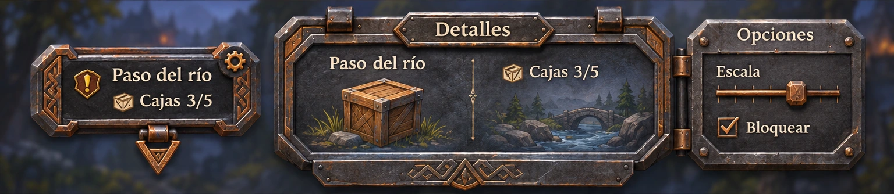
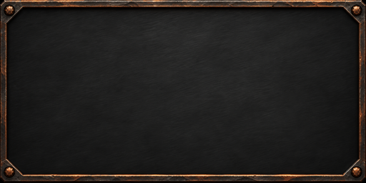
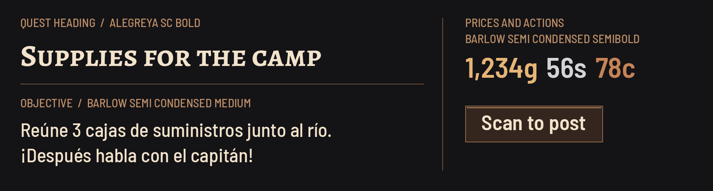
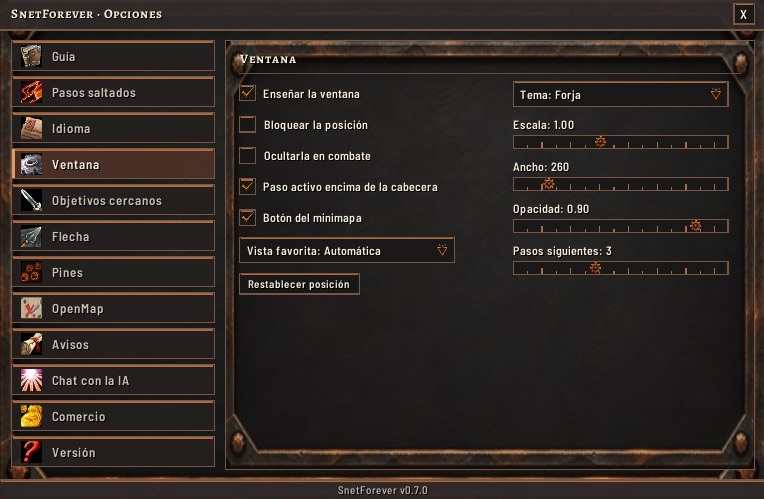
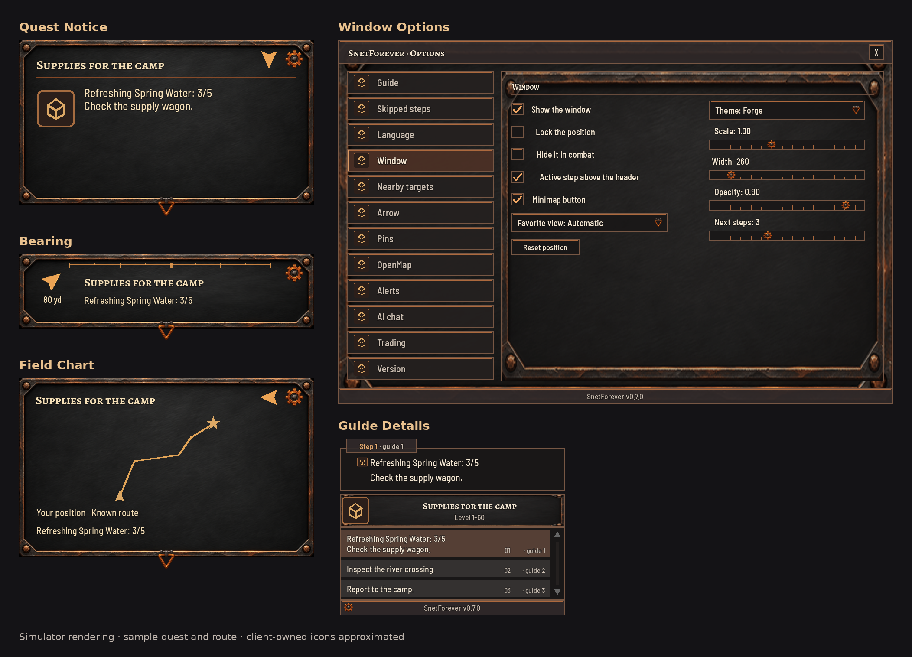
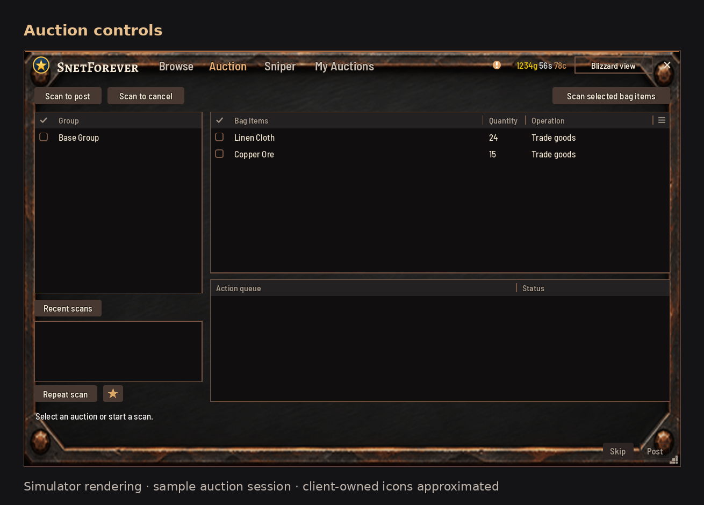

<p align="center">
  
</p>

# SnetForever

A World of Warcraft Forever addon and Windows companion for leveling, quest guidance, in-game AI chat, and auction management.

[Design gallery](docs/design/) · [Documentation](docs/README.md) · [Contributing](CONTRIBUTING.md)

## What it does

- **Guides.** Follow leveling routes and quest steps in the game.
- **Auction tools.** Browse listings, prepare sales, and track your auctions. The player initiates auction actions.
- **AI chat.** Ask questions in the game. The Windows companion passes along game context and connects to the configured AI backend.

## Addon interface



*Selected design concept.* The quest title opens the notice, the direction arrow opens the field chart, the copper pull ring opens **Details**, and the cog opens **Options**. The guide and auction windows share the dark iron and copper treatment. Alegreya SC titles and Barlow Semi Condensed labels distinguish quest names, controls and prices.

| Options and Details controls | Panel material |
| --- | --- |
|  |  |

<details>
<summary>Forge typography in English and Spanish</summary>



</details>

### Window options in the game



### Guide, settings and auctions

| Guide views and Window options | Auction controls |
| --- | --- |
| [](docs/design/images/forge-interface-guide.png) | [](docs/design/images/forge-interface-auction.png) |

Click either image for the full-size view. These previews use the addon's frame layout and textures with sample data. The previews use the bundled Forge fonts and approximate the built-in game icons. See the [design gallery](docs/design/) for the earlier concepts and the decisions behind the menus and buttons.

## Repository layout

| Path | Responsibility |
| --- | --- |
| [`addons/`](addons/) | Lua modules loaded by WoW Forever for the addon core, auctions, missions, and routes |
| [`app/`](app/) | Windows companion, bundled resources, and app tests |
| [`tools/`](tools/) | WoW simulator, data converters, art generators, and installer tooling |
| [`templates/`](templates/) | Example package for custom guides |
| [`scripts/`](scripts/) | Repository-wide verification and preview-build entry points |
| [`docs/`](docs/) | Design gallery, guide references and auction workflows |
| [`.github/`](.github/) | Verification, Windows preview automation, and contributor templates |

## Development

Use Node.js 24 and npm. Run these commands from the repository root.

```sh
npm run bootstrap
npm run check
```

`bootstrap` installs the locked dependencies for the simulator and converters. `check` runs smoke tests across the addon, app, and packaging. See the [contribution guide](CONTRIBUTING.md#verification) for the full suites and platform requirements.

SnetForever is maintained by David ([@davrodwconnections](https://github.com/davrodwconnections) and [@davidrod-WaveNorth](https://github.com/davidrod-WaveNorth)) and Alain ([@alvarezalain262-create](https://github.com/alvarezalain262-create)). See the [project license and component notices](LICENSE.md) for collaboration permissions, existing open licenses and third-party credits.
