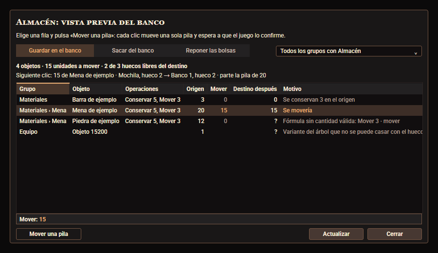

# Warehousing

Warehousing operations decide what moves between your bags and your personal bank. SnetForever previews those moves. With the **Move one stack** button, each of your clicks moves one stack, or part of one, as shown in the preview.

## Previewing a move

1. In **Groups**, give a group one or more **Warehousing** operations, directly or through a parent group.
2. Open your bank in the game and type `/snet c almacen` (or `/snet trade warehouse`).
3. Choose **Deposit to bank**, **Withdraw from bank** or **Restock bags**, then choose all groups with Warehousing or one group with its subgroups.
4. Read each row: the group, its operations, how many are in the source, how many would move, the total the target would have afterwards and the reason when nothing moves.
5. To move a stack, click one row. The line above the table names the next move: the quantity, the source bag and slot, and the target bag and slot. Press **Move one stack** once for that stack. Repeat for each stack, or move the items yourself.

The preview refreshes when your bags or bank change, merging bursts of updates into one refresh. It keeps the table unchanged when the result is unchanged. In combat it pauses and keeps the last result on screen.

## How quantities are calculated

The rules follow TSM 4.15.9 (`WarehousingOperation.lua` and the Banking service). An item uses every Warehousing operation of its group in order. An operation ignored for the current character or house is skipped and the others still apply. An item without a group belongs to the Base Group.

| Direction | Source | Quantity |
| --- | --- | --- |
| Deposit | Bags | Each operation adds up to its **Quantity to move** (0 means all), with the highest bag reserve encountered so far. |
| Withdraw | Bank | Each operation adds up to its **Quantity to move**, with the highest bank reserve encountered so far. Rounds down to a multiple of the stack size. |
| Restock | Bank | Uses operations with a **Restock quantity** above 0. Units already in your bags count toward the targets in order. Each operation uses the highest restock reserve encountered so far and rounds down to its restock stack size. |

As in TSM, a reserve from a later operation limits that operation and the ones after it. It does not undo units already allocated by earlier operations.

A formula that does not give a whole number from 0 to 50,000 (0 to 200 for a stack size) sets the whole item to zero, as in TSM. The row names the operation and field. A formula that depends on a missing price behaves the same way.

As in TSM, a move fills empty target slots and does not top up existing stacks. Every source slot that a move uses needs one free target slot. The reagent bag is not counted as a deposit target. Rows that do not fit show how many more free slots they need.

## What the preview does not assume

- **Closed bank.** No preview is shown. A bank that has not been read is not treated as empty.
- **Unreadable slots.** If the game reports a slot as occupied without its item or count, every affected row is uncertain and shows `?`.
- **Variants and pets.** A bag slot gives a base item ID. Group entries with a suffix, bonus or pet species cannot be matched to it and are set aside with a reason.
- **Account bank.** Account bank tabs (15 to 23 in Forever) are outside this delivery.

## Imported settings

The TSM import maps all seven Warehousing fields: `moveQuantity`, `stackSize`, `keepBagQuantity`, `keepBankQuantity`, `restockQuantity`, `restockStackSize` and `restockKeepBankQuantity`. It keeps each operation's ignored characters and houses and its links to other operations. Group assignments keep TSM inheritance. TSM does not assign its default Warehousing operation to the Base Group. TSM has no separate target stock field. Restock quantity is the target in the bags.

## Moving one stack per click

Each player click can move one item stack. Only `comercio/almacen-mover.lua` may call `C_Container.PickupContainerItem` and `C_Container.SplitContainerItem`. The repository check rejects both functions in every other file. It still rejects the global forms, `_G` lookups, `UseContainerItem` and every other item API in that file. The exception covers bags and the personal bank only. It does not cover buying, selling, using, equipping or destroying items, other places or other addons.

Each click on **Move one stack** does the following:

1. It checks the chosen row again: the preview is still current, the bank is open, you are out of combat, the source slot holds the same item with the same link and count and is not locked, the target slot is empty and belongs to a regular bag, and the cursor is empty.
2. It splits the source stack onto the cursor, or picks up the whole stack. It checks the cursor link and destination again before placing the stack in that slot.
3. It waits until the game shows both slots as expected (the remainder in the source, the moved units in the target, neither locked) and the cursor is empty. Until then the button is off and further clicks do nothing.

Events and timers only check the slots. They never move anything again. After 5 seconds without confirmation the line says so and still accepts no new move. **Refresh** only checks the slots. Closing the bank ends the wait and leaves the result to you.

| Situation | What happens |
| --- | --- |
| A later operation has a higher reserve than the one that limited earlier operations | The move keeps the highest reserve, so it can move less than the preview. If the operations also require stack multiples, the button stays off and the line explains why. |
| No empty slot in a regular target bag | Nothing moves. The reagent bag and special bags are never targets. |
| Source locked, its lock state unknown, or a stack of the item with a suffix, gems or bonus IDs | Nothing moves. |
| Cursor holds something | Nothing moves. |
| Both slots still look unchanged or show only part of the move | A stale read and a rejected move can look alike. The button stays off until both slots show the move or the bank is closed. |
| The target refuses the stack and it stays on the cursor | Moving stops. You place the stack yourself. |
| The game blocks or forbids the call, or the call fails | Moving is off until you reload the interface. The window returns to the read-only preview. |
| The client lacks one of the functions | The window stays a read-only preview. |

The source is the first stack of the item in bag order, or the first unlocked stack large enough for the planned amount when the operation requires stack multiples. The target is the first empty slot of a regular bag on the other side. TSM uses the same split and place sequence (`LibTSMService/Source/Banking/Internal/MoveContext.lua`). TSM moves every stack of a run at once and, if a stack is not confirmed within two seconds, moves it again. SnetForever moves one stack per click and never retries.

### Evidence and what it does not prove

- Blizzard interface source, `forever` branch of `Gethe/wow-ui-source` (version 1.60.1.71139, commit `d9c22e3`, `Blizzard_APIDocumentationGenerated/ContainerDocumentation.lua`): `PickupContainerItem` and `SplitContainerItem` have no restriction flag. Their `SecretArguments` value is `AllowedWhenUntainted`, so the executor passes ordinary numbers only. `ContainerItemInfo.isLocked` and the `ITEM_LOCK_CHANGED`, `BAG_UPDATE` and `BAG_UPDATE_DELAYED` events exist. `CursorDocumentation.lua` lists `CURSOR_CHANGED`.
- TSM 4.15.9 installed for Forever (read only): `LibTSMWoW/Source/API/Container.lua` calls both functions from its banking thread, outside a click, and `Banking/Internal/Move.lua` confirms a move by reading the source count.
- The documentation does not say whether the server requires a hardware event, how long it takes to confirm, or how the slots look while a move is pending. The simulator assumes that the source stays locked and the target stays empty until the server answers.

## Forever client checks

The following checks require the Forever client.

- Whether one click on **Move one stack** moves exactly one stack between the bags and a character bank tab, and whether `ADDON_ACTION_BLOCKED` or `ADDON_ACTION_FORBIDDEN` appears.
- What `GetContainerItemInfo` reports for both slots while a move is pending (`isLocked`, the count in the source after a split, and whether the target already shows the item), and which events report completion.
- The `bagFamily` value that `GetContainerNumFreeSlots` returns for character bank tabs. Moving to the bank requires 0. Another value leaves deposits as preview only.
- What the cursor reports after picking up a partial stack and when the target refuses a stack.
- Bank tabs that report no slots. They may be unpurchased or not yet loaded, and the preview reads only tabs that report slots.
- How `BANKFRAME_OPENED` and `BANKFRAME_CLOSED` behave when switching between the character and account bank tabs.
- Whether `C_Container.GetContainerItemInfo` returns items without an ID or with a hidden count while the bank loads.
- The reagent bag as a target for reagents. The preview does not count it.
