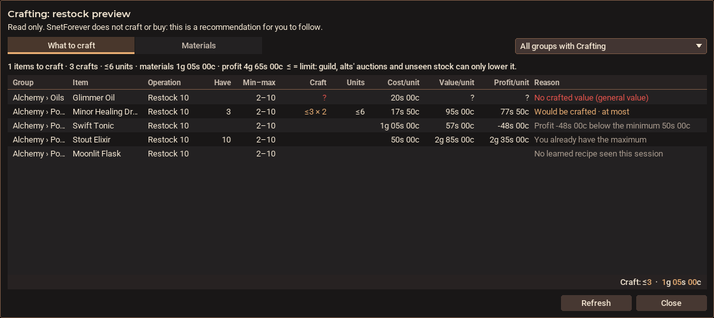
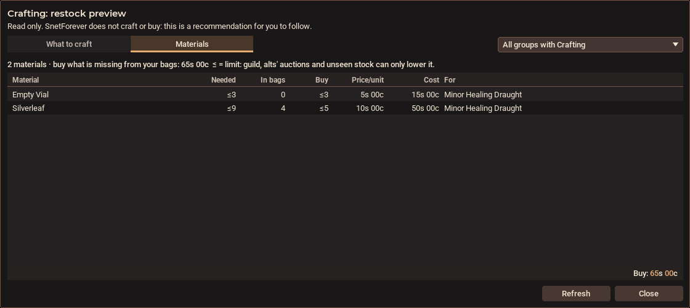

# Crafting

Crafting operations decide how many of each crafted item you keep in stock. SnetForever previews what TSM's restock would queue and which materials it needs. It does not craft, buy, use or move anything.

## Previewing a restock

1. In **Groups**, give a group a **Crafting** operation, directly or through a parent group. The Base Group is never restocked, as in TSM.
2. Open your profession window once in this session, so SnetForever can read your learned recipes.
3. Type `/snet c artesania` (or `/snet trade crafting`). The profession window doesn't have to stay open.
4. Choose all groups with Crafting or one group with its subgroups. Read **What to craft** and **Materials** and craft or buy yourself.

**What to craft** shows the group, the operation, the units you have, the minimum and maximum restock, how many crafts and units would be queued, the cost, value and profit per unit, and the reason when nothing is queued. **Materials** adds up the materials for every row that would be crafted and shows what is in your bags, what is missing and what buying the missing units would cost at the app's normal price.

The preview refreshes when the game updates your bags, bank, mailbox, auctions or learned recipes. It merges bursts of updates into one refresh. In combat it pauses and keeps the last result on screen.

## How restocking is calculated

The rules follow TSM 4.15.9 (`CraftingOperation.lua` and `Crafting/Internal/Restock.lua`), read in the installed copy.

1. The item uses the first Crafting operation of its group. Crafting accepts one operation, so an operation ignored for the current character or house leaves the item without one.
2. **Minimum restock quantity** and **Maximum restock quantity** are whole numbers from 0 to 50,000. If a formula has no value, is out of range or the minimum is above the maximum, the operation is invalid and nothing is queued.
3. The recipe is the cheapest learned recipe whose materials all have a price. When none has a cost and there is exactly one recipe, TSM still uses it without a cost.
4. With **Require a minimum profit** on, `value − cost per unit` must reach the minimum profit. Without a value, a cost or a minimum profit value, nothing is queued. A negative minimum is accepted, as in TSM.
5. `missing = maximum − units you have`. Nothing is queued when `missing ≤ 0` or `missing < minimum`. Otherwise the crafts are `floor(missing / units per craft)`, so a recipe that makes more than is missing is not queued.

The value is the operation's own formula when **Override the crafted value** is on and the formula is not empty. Otherwise it is TSM's shipped default craft value, `first(DBMinBuyout, DBMarket) * 0.95`, translated to `first(snfminimo, snfmercado) * 0.95`.

### Where SnetForever differs from TSM

- **Units you have.** TSM's total inventory adds bags, bank, warband bank, mail, auctions, alts and guild banks. SnetForever counts the live bags of the character playing, and the bank, account bank and mail of each own character of the realm once they have been seen. It counts your auctions only while your auction list is loaded. A bank or mailbox never opened is not taken as empty. Guild banks and other characters' auctions have no source in SnetForever. Rows therefore show the crafts as `≤ n`: what is still uncounted can only lower the number. The row names the sources that have not been seen yet.
- **Ignored characters and guilds.** TSM's general Crafting settings can leave characters and guilds out of the inventory count. Those lists are not imported.
- **Recipes.** SnetForever reads learned recipes from each profession window opened in the current session. It requires a fixed yield and one material per required slot. The estimate uses the required materials and the base yield, excluding optional reagents and bonuses. A recipe with variable yields or multiple choices for a required reagent is unavailable in the preview. TSM also knows recipes of other characters of the account.
- **Cost.** Each material costs the app's normal price (the same cost as the `crafting` formula source). TSM uses its general material price, `min(DBMarket, Crafting, VendorBuy, Convert(DBMarket))` by default, and per-material overrides, rounds to the nearest copper and can apply expected refund and extra yield rates. SnetForever rounds the cost per unit up.
- **General craft value.** A craft value method changed in TSM's general settings is not imported. Only the operation's own formula overrides the shipped default.
- **Missing data.** A value, cost or minimum profit that cannot be calculated makes the row uncertain and names the missing data. Without a minimum profit, a recipe without a cost is still recommended and the row names the materials without a price.
- **Variants and pets.** A group key with a suffix, bonus or pet is set aside, because recipes are read by base item.

## Imported settings

The TSM import maps the four Crafting fields: `minRestock`, `maxRestock`, `minProfit` and `craftPriceMethod`. An empty `minProfit` turns **Require a minimum profit** off, and an empty `craftPriceMethod` turns **Override the crafted value** off. The import keeps each operation's ignored characters and houses and its links, and translates `DBMarket`, `DBMinBuyout` and `DBHistorical` in the formulas. It does not read TSM's general Crafting settings (`defaultCraftPriceMethod`, `defaultMatCostMethod`, per-material prices, ignored characters and guilds) or TSM's crafting queue.

## Crafting and buying are not available

The design rules prohibit the addon from playing for the player. The preview never calls `C_TradeSkillUI.CraftRecipe` or any purchase or bag function. TSM queues crafts and crafts them from its queue with one click per craft. An executor would need:

1. A recorded design decision that allows crafting from the addon, or a decision to keep Crafting read only.
2. Measurements in the Forever client: whether `C_TradeSkillUI.CraftRecipe` needs a hardware event, how it reports quantities, and how recipes with a variable yield, optional reagents or quality reagents read in `GetRecipeSchematic`.
3. One action per click, with recipes, bags and formulas checked again immediately before it. `SNF.Artesania.vigente(vista)` already detects any change since the preview.

Buying the missing materials can already go through **Group shopping**: put the materials in a group with a Shopping operation and scan it at the auction house.

## Forever client checks

- Whether `C_TradeSkillUI.GetAllRecipeIDs`, `GetRecipeInfo` and `GetRecipeSchematic` report `learned`, `quantityMin`, `quantityMax` and the reagent slots for every profession, and whether `TRADE_SKILL_LIST_UPDATE` fires when the window opens.
- Which recipes in Forever have a variable yield or several reagent choices, and therefore are not read.
- Whether `C_Item.GetItemCount(item, false)` counts equipped items or the reagent bag in Forever.
- Whether a real TSM export from Forever has Crafting operations with the four fields named as above.
- How the restock count compares with TSM's for the same character once bank and mail have been seen.
