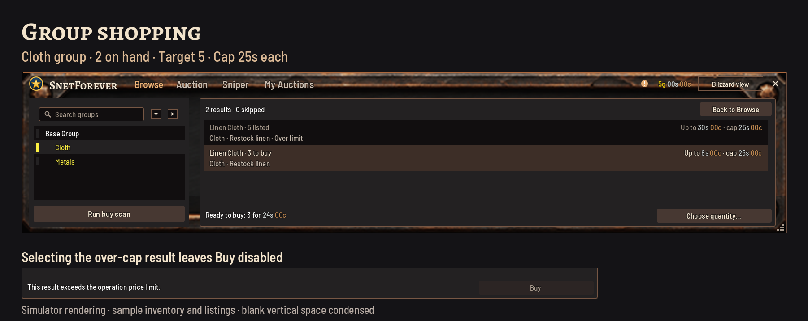

# Auction operations

## Buying for a group

1. In **Groups**, assign items to a group and give it a **Shopping** operation, directly or through its parent.
2. Set a maximum unit price. To buy only missing stock, set a restock target and choose which inventory locations to count. A target of zero disables the stock target.
3. At the auction house, open **Browse**, select the groups, and run the buy scan. Results identify the group, operation, cap, price and proposed quantity. If the operation shows offers above its cap, those rows are informational.
4. Select an eligible offer to refresh it. For commodities, choose a quantity before requesting a quote. Review the current amount and confirm in the game. Leaving the scan or closing the auction house stops its requests.

The example uses synthetic stock and prices. With two units on hand and a target of five, the scan recommends three units at 8 silver each. A separate 30-silver listing exceeds the 25-silver cap. Because the commodity purchase API quotes a total, some recommendations are split into smaller quantities to guarantee that each unit remains inside the cap. Exact variant listings, unavailable inventory sources and missing prices can affect eligibility. The scan does not substitute a base item for a qualified item key.

## Posting with multiple operations

Applicable Auctioning operations run in the order saved on the group. Each operation evaluates its prices, posting limit and bag reserve. Active listings and inventory already allocated in the scan count toward later limits. For example, with no active listings and sufficient stock, a first limit of 20 followed by a limit of 50 allows up to 20 units under the first rule and 30 more under the second. Each posting and cancellation requires a player action. A cancellation scan proposes at most one row for an owned auction ID. Changing a pricing or cancellation rule can require a fresh scan. If a posting acknowledgement is interrupted, check My Auctions before retrying. When the server cannot identify a unique matching new listing, the queue keeps posting locked. After checking the actual listings, reload the UI and run a new scan.

## Price expressions and imports

Price expressions support exponentiation and explicit numeric item references. For example, `vendorsell(item:1234)` reads the vendor sale value of that item when it is available. Missing values propagate through the expression or can be handled with `first`. SnetForever's local market estimates and TSM's realm or regional series can yield different prices.

After you open a merchant, `vendorbuy` can use that merchant's observed gold-only unit price, including the price per unit in a bundle. The in-memory snapshot lasts up to 15 minutes and is invalidated on world entry or a faction update. Unavailable, out-of-stock, and currency-exchange offers do not supply a price.

Plain-text group lists preserve supported numeric item IDs, item variants such as `i:8836::1:3` and `i:8838::r42`, and pet keys such as `p:1124:10:3`. A qualified key is stored separately from its base ID. Inspect the import summary for unrecognized entries before applying changes.

## Recipe costs and materials

Open a profession with a learned, fixed-output recipe to observe its required reagents through the client schematic API. The `crafting` formula uses the least expensive observed recipe with a known market price for every required reagent. Recipes with alternative required reagents or variable outputs do not supply a cost. Use `/snet trade materials ITEM_ID UNITS` to see the number of crafts, ingredients and bag shortfalls. Observations last for the session. No crafting action is submitted.

## Specialized browse searches

Enter an item name and select **Vendor search** to see offers below the known NPC sell price. Missing item data produces no recommendation. For an advanced search, enter e.g. `advanced:15:2:cloth` and press Enter. The two numbers are minimum item level and quality (0 disables that filter). Only the name is sent to the auction house. Recent and favorite searches preserve the filters.

For disenchant search, record the outputs from a measured batch with `/snet trade yield ITEM_ID ATTEMPTS MATERIAL_ID:TOTAL [MATERIAL_ID:TOTAL ...]`. Recording again replaces that item’s batch. **Disenchant search** filters named results by the observed mean output value using current local material prices. It excludes items without samples or prices. Sampling is manual and the estimate does not guarantee a return.

Daily departures estimate how many units disappeared early in snapshots of the local auction house. They include cancellations, with additional filtering for commodities. They are not confirmed sales or a regional TSM series. To investigate a quantity discrepancy, compare the same item variant, house and observation time with a completed listing query.

## Remaining work

| Area | Next acceptance check |
| --- | --- |
| Specialized searches | Verify advanced, vendor and disenchant searches with real Forever listings and measured disenchant batches. |
| Price coverage | Extend observed merchant pricing and obtain verified recipe costs and disenchant yields before exposing new inputs. |
| Packed group strings | Validate a real exported group and its operations against its source. Plain-text lists and saved profiles have separate readers. |
| Live auction behavior | Verify posting, cancellation, repricing and quantity selection in a controlled session, including closing the window mid-scan. |
| Broader economy tools | Plan the crafting queue, mailing, warehousing and vendoring workflows independently of the auction window. |

### Economy workflow acceptance criteria

| Workflow | Inputs to verify in Forever | First usable result |
| --- | --- | --- |
| Crafting | Known recipe, output count, reagent counts and available inventory | Show a restock queue, material shortfall and cost. Mark unknown prices explicitly. |
| Mail | Recipient, mailable item, bag slot and reserved quantity | Preview recipient, attachments and postage. Recheck the recipient and stack before each player-confirmed send. |
| Warehousing | Open bank, storage type, free slots and counts on both sides | Preview deposits and withdrawals. Reconcile each movement against the next inventory update. |
| Vendoring | Open merchant, bundle size, stock, price, reserves and sell restrictions | Preview eligible purchases and sales. Stop on merchant close and require a click before each transaction. |
