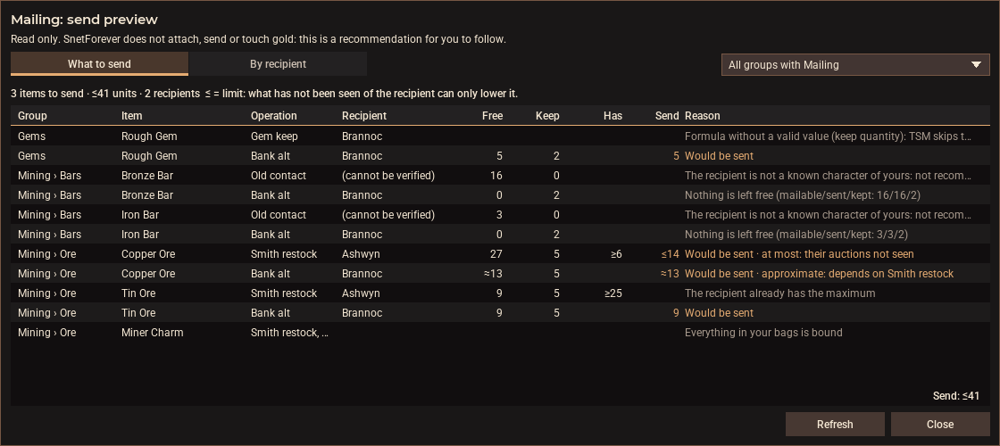
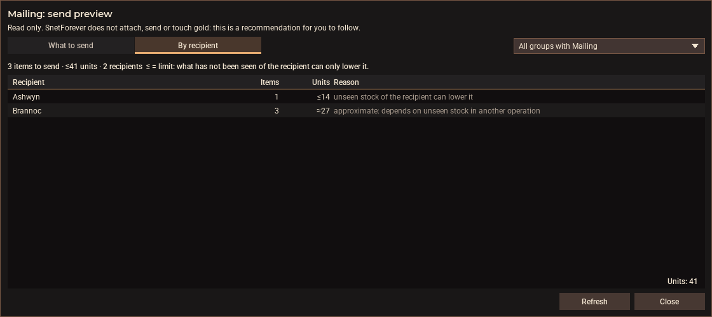

# Mailing

Mailing operations decide which items in your bags go to your other characters and how many you keep. SnetForever previews what TSM's group mailing would send. It does not attach, send, collect, return or delete mail, it does not touch gold and it does not write in the mailbox send form.

## Previewing what to send

1. In **Groups**, give a group one or more **Mailing** operations, directly or through a parent group.
2. Log in once with each character you send to, so SnetForever knows it is yours. Open their bags, mailbox and bank once if the operation restocks them.
3. Type `/snet c correo` (or `/snet trade mailing`). The mailbox doesn't have to be open.
4. Choose all groups with Mailing or one group with its subgroups. Read **What to send** and **By recipient** and send the items yourself.

**What to send** has one row per item in your bags and Mailing operation: the group, the operation, the saved recipient, the units still free at that operation, the largest keep quantity so far, what the recipient already has when the operation restocks, the units that would be sent and the reason when nothing is sent. **By recipient** adds up the units and items each character would receive.

The preview refreshes when the game updates your bags, bank, mailbox or auctions. It merges bursts of updates into one refresh. In combat it pauses and keeps the last result on screen.

## How sending is calculated

The rules follow TSM 4.15.9 (`MailingOperation.lua`, `SendTargetIterator`, and the dry run in `Mailing/Internal/Groups.lua`), read in the installed copy.

1. Only items in your bags count, and only the units in slots that are not bound.
2. Every Mailing operation of the group applies, in order. An operation ignored for the current character or house, or without a recipient, is skipped and the next one applies.
3. **Keep quantity** must be a whole number from 0 to 50,000. With **Set a maximum quantity** on, the maximum must be from 1 to 50,000. Otherwise TSM skips the operation silently; the preview names the formula.
4. `keep = largest keep quantity so far` and `free = mailable units − units already sent − keep`. Keep quantities are not added together.
5. With nothing free, nothing is sent. Without a maximum, the operation sends everything free. With a maximum, it sends `min(free, maximum)`. With **Restock the recipient to the maximum**, it sends `min(free, maximum − what the recipient has)`.
6. When the recipient is the character playing, nothing is sent and that quantity becomes part of the keep quantity.
7. What the recipient has is their bags, mail and auctions, plus their bank and guild when the operation selects those sources.
8. A recipient in several operations receives the sum.

### Where SnetForever differs from TSM

- **Recipient.** SnetForever recommends sending only to your own characters on the current realm, known from logging in with them or from the TSM import. TSM sends to any name. A recipient that is not one of your characters, or is on another realm, is not shown and its row is not recommended. The units TSM would send to it are still deducted, so the later operations show what TSM would do. The preview does not store or display that name.
- **What the recipient has.** Only what has been seen counts. A mailbox or bank never opened, the recipient's auctions (SnetForever sees only the auctions of the character playing) and guild banks are not taken as empty. The row names them and the quantity sent becomes a limit, `≤ n`. When that limit changes what is left for later operations, their quantities show `≈ n` and name the operation they depend on. A combined total is approximate when it includes a quantity that can change in either direction. Items you sent are not seen until the recipient opens the mailbox. TSM also tracks its own pending mail.
- **Recipient never seen.** A character without an inventory snapshot counts as 0 and the row says so.
- **Bound items.** A slot whose bound state the game does not report makes the item uncertain. Forever does not tell SnetForever whether an item is warbound, so warbound items, which TSM can mail, are not counted as mailable.
- **Variants and pets.** Bag slots are matched by base item. When the group tree has a variant of the item (suffix or bonus), the base item counts only slots whose links identify the base item. A missing link makes that base row uncertain. The variant row is set aside. Caged pets are not matched with their `p:` key.
- **Base Group.** TSM can mail ungrouped items with the Base Group's operations. The preview covers named groups only.
- **Mail size.** TSM splits the items into letters by the client's attachment limit and can send each item in its own letter. The preview counts units and does not plan letters or postage.

## Imported settings

The TSM import maps the six Mailing fields: `target`, `keepQty`, `maxQtyEnabled`, `maxQty`, `restock` and `restockSources` (`bank` and `guild`). It keeps a recipient only when it is one of your characters; other names are counted as removed and are not saved. The preview compares the stored recipient with your characters using the same name and realm rules as the import. TSM's general Mailing settings (restart delay, send grouped items individually, bag space to keep free) are not imported.

## Sending is not available

The design rules prohibit the addon from playing for the player. The preview never calls `SendMail`, `ClickSendMailItemButton`, `SetSendMailMoney`, `TakeInboxItem`, `DeleteInboxItem` or any container function that picks up or splits items, and it never writes in the send form. An executor would need:

1. A recorded design decision that allows mailing from the addon, or a decision to keep Mailing read only.
2. Measurements in the Forever client: whether attaching and `SendMail` need a hardware event, how postage and the attachment limit behave, and how the client reports bound and warbound slots.
3. One action per click, with bags, recipients and formulas checked again immediately before it. `SNF.Correo.vigente(vista)` already detects any change since the preview.

## Forever client checks

- Whether `C_Container.GetContainerItemInfo` reports `isBound` for every bag slot, and how warbound items read.
- Whether a real TSM export from Forever stores Mailing recipients as `Name`, `Name-Realm` or with the surname separator, and whether the preview recognizes them.
- Whether characters of the account that never logged in with SnetForever appear through the TSM inventory import.
- How the units compare with TSM's dry run (Ctrl-click the send button on the Groups tab of TSM's mailbox) for the same character once bags, mail and bank have been seen.
