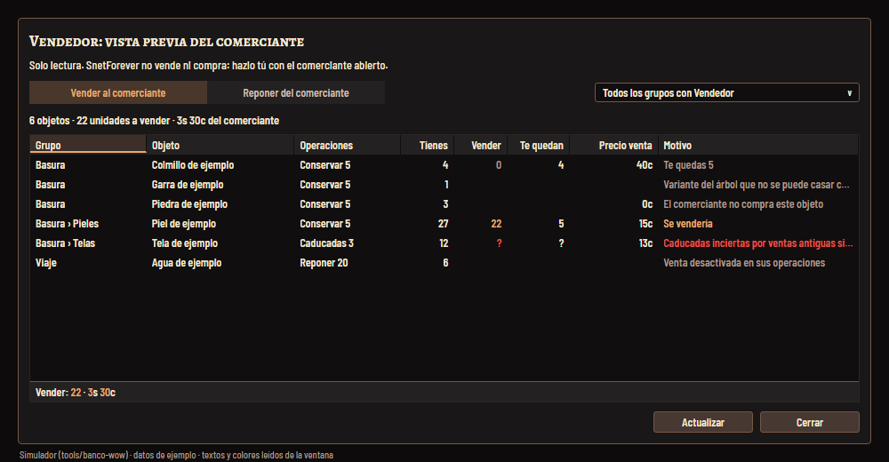
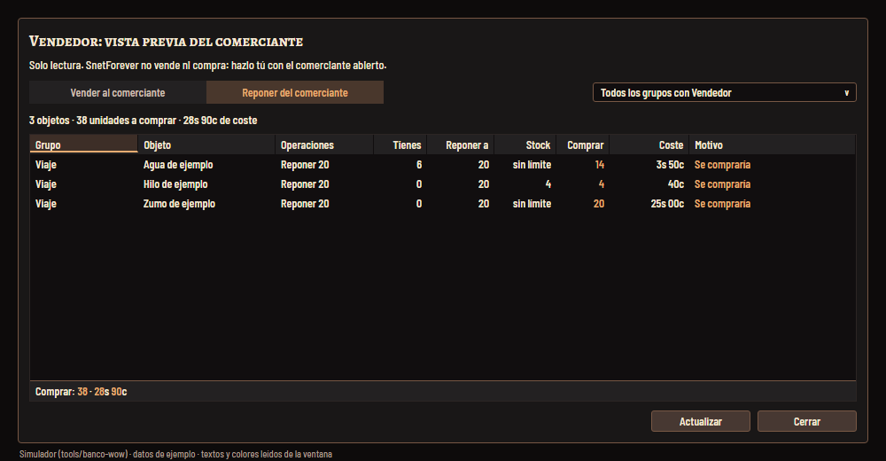

# Vendoring

Vendoring operations decide what you sell to a merchant and what you buy from one to restock. SnetForever previews both. It does not sell or buy.

## Previewing a merchant

1. In **Groups**, give a group one or more **Vendoring** operations, directly or through a parent group.
2. Talk to a merchant in the game and type `/snet c vendedor` (or `/snet trade vendor`).
3. Choose **Sell to merchant** or **Restock from merchant**, then choose all groups with Vendoring or one group with its subgroups.
4. Read each row and sell or buy the items yourself.

The sell tab shows the group, the operations, the units in your bags, the units that would be sold, the units you would keep, the merchant's sell price per unit and the reason when nothing is sold. The restock tab shows the units you have, the restock quantity, the merchant's stock, the units that would be bought, their cost and the reason.

The preview refreshes when your bags or the merchant change, merging bursts of updates into one refresh. It keeps the table unchanged when the result is unchanged. In combat it pauses and keeps the last result on screen. Closing the merchant closes the window, and the command does nothing without an open merchant.

## How selling is calculated

The rules follow TSM 4.15.9 (`VendoringOperation.lua` and the Vendoring group sell thread, which prints the same result in its dry run). An item without a group belongs to the Base Group. Only items in your bags are listed.

1. Every Vendoring operation of the item's group is used in order, except operations ignored for the current character or house and operations with **Enable selling** off.
2. Each operation proposes `units in bags − Keep quantity` when all of these hold:
   - **Keep quantity** and **Sell after expired** are whole numbers from 0 to 50,000. Otherwise that operation proposes nothing and the row names the field.
   - With **Sell after expired** above 0, the item expired at least that many units since its last auction sale.
   - With a maximum destroy value or market value above 0, the item's value is below it.
3. TSM sells each proposal in turn with what is still in the bags. Two selling operations therefore add up instead of using the larger reserve. The row says when that happens.
4. Without **Sell bound items**, bound slots are not sold. Stacks are sold from smallest to largest. A stack larger than what is left needs one free bag slot to split. Without one, TSM stops at that stack and the row says so.

### Where SnetForever is stricter than TSM

- **Missing values.** TSM treats a missing market or destroy value as zero and sells. SnetForever marks the row uncertain and names the formula. A maximum whose formula has no value is also uncertain. Only an explicit `0c` turns a check off.
- **Expiries.** The count adds expired units of the base item since the last sale, for every character of the realm, from the auction mails SnetForever has read. A sale mail has no attachment, so most sale rows have no item ID. When a sale without an ID, with the item's name, is newer than some of the expiries, the row shows both counts and stays uncertain unless both counts give the same answer. The figure never includes TSM's older history and can only fall short of it.
- **Merchant refusal.** An item whose sell price is 0 or whose slot is flagged as having no value is set aside with **The merchant does not buy this item**. TSM would try to sell it in a group. An item the client has not loaded yet has no price, and the row stays uncertain.
- **Unreadable data.** An occupied slot without an item or count, a bag without a free slot count, or a slot whose bound state is not reported when the operation does not sell bound items makes the row uncertain and shows `?`.
- **Variants and pets.** A slot with a random suffix or bonus counts as the base item, as in TSM, while the tree has no variant of that item. When the tree has a variant, a slot with a suffix, bonus or unreadable link cannot be matched and is set aside. Pet cages are set aside.

## How restocking is calculated

For each item in a chosen group, SnetForever previews the first in-stock offer for the base item with a known gold price. A row with a different payment method or no stock can't hide another offer for the same item. It uses the **first** Vendoring operation of the group that is not ignored here, as TSM does. If that operation has **Enable buying** off, nothing is bought and later operations are not tried. Otherwise it proposes `Restock quantity − units you have`, up to the merchant's stock.

Units you have always include your bags. **Bank** and **Alts** use the account inventory and **Auctions** uses your posted auctions. **Guild**, **Alt auctions** and **Mail** have no verified source in SnetForever, so a row that selects them is uncertain. A bank or alt that has not been seen also leaves the row uncertain. Merchant rows with an extended cost, currency or spell, unreadable price or stack size, or no stock are set aside with their reason. The cost uses the price per unit read from the merchant.

## Imported settings

The TSM import maps all eleven Vendoring fields: `sellAfterExpired`, `sellSoulbound`, `keepQty`, `restockQty`, `restockSources`, `enableBuy`, `enableSell`, `vsMarketValue`, `vsMaxMarketValue`, `vsDestroyValue` and `vsMaxDestroyValue`. It keeps each operation's ignored characters and houses and its links. TSM does not assign its default Vendoring operation to the Base Group. `DBMarket` in the default market and destroy values is translated to a local estimate, so the result can differ from TSM.

## Selling and buying are not available

The design rules prohibit the addon from playing for the player. The repository check prohibits `UseContainerItem`, `PickupContainerItem` and `SplitContainerItem`. TSM sells by using each bag slot with the merchant open and splits a stack onto the cursor first when it sells part of it. It buys with `BuyMerchantItem`. An executor needs the following before it can be considered:

1. A recorded design decision that allows a click-per-action exception, or a decision to keep Vendoring read only.
2. Measurements in the Forever client: whether using a slot at a merchant needs a hardware event, how locked slots and the buyback list behave, and how `BuyMerchantItem` counts units for merchant rows sold in stacks.
3. One action per click, with the merchant, bags, operations and formulas checked again immediately before it. `SNF.Vendedor.vigente(vista)` already detects any change since the preview.
4. Simulator support for selling, buyback and delayed bag updates.

## Forever client checks

- Whether `C_Container.GetContainerItemInfo` reports `hasNoValue` and `isBound` for every slot, and whether it returns slots without an ID or with a hidden count while bags load.
- Whether `GetItemInfo` returns a sell price of 0 for every item a merchant refuses.
- How `MERCHANT_SHOW`, `MERCHANT_UPDATE` and `MERCHANT_CLOSED` behave when the merchant's stock changes.
- The stack size and price of merchant rows sold in stacks of more than one.
- Whether the auction expiry and sale mails of Forever give the same subjects and invoice fields as the ones SnetForever reads.
