# Interface design gallery

[Dwarven Forge](#dwarven-forge) is the selected visual direction for the guide, its settings and the auction interface. The concept illustrations below use fictional game scenes and sample objectives. The PNG material previews come directly from the addon's texture files.

## Dwarven Forge

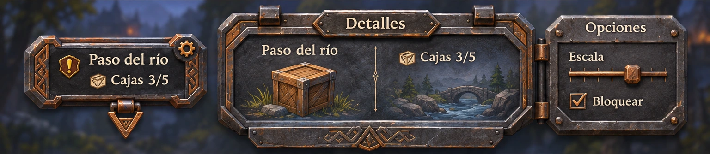

*Selected concept, option 2.* The compact tracker carries the objective. A copper pull ring opens the detailed step list. A cog opens the settings panel. Dark iron gives the control edges a recognizable silhouette while ivory labels remain readable against the center of the plate.

| Area | Design decision | Reason |
| --- | --- | --- |
| Quest notice | Show the current objective and its live progress. Press the quest title to open the notice from Bearing. | A player can read the assignment without navigating a list of screens. |
| Bearing and field chart | Fold the notice while traveling. Open the chart from the direction arrow. Draw a trail only for known route geometry. | The player can switch views without advancing the quest or mistaking a straight line for a walkable route. |
| Details | Use the pull ring for advanced guide controls, including the step list and manual checkboxes. | The controls remain available during play while leaving the compact tracker clear. |
| Options | Open settings from the cog. Put the preferred-view selector in the window settings. | Pinning a preferred view is an occasional choice and does not need a permanent text button. |
| Auction interface | Use the iron and copper treatment around the auction tools. Keep price and status colors meaningful and leave auction actions under player control. | The guide and the auction window belong to the same addon, while the player still needs to recognize a warning or confirm a transaction. |

### Window options in WoW Forever

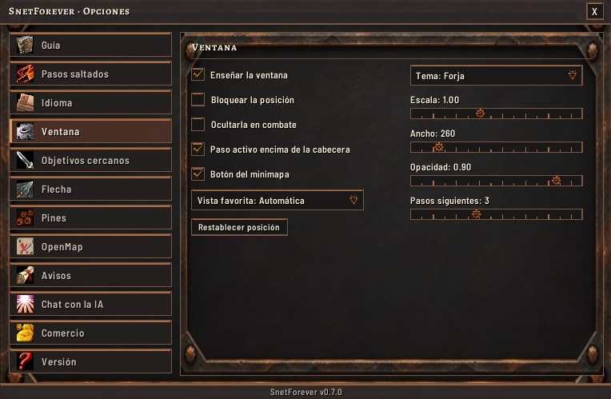

*In-game capture after a UI reload.* The client originally displayed eight blank navigation labels, two blank selectors and the previous blue borders. This capture verifies the corrected labels and the iron and copper palette at the settings shown.

### Implemented interface

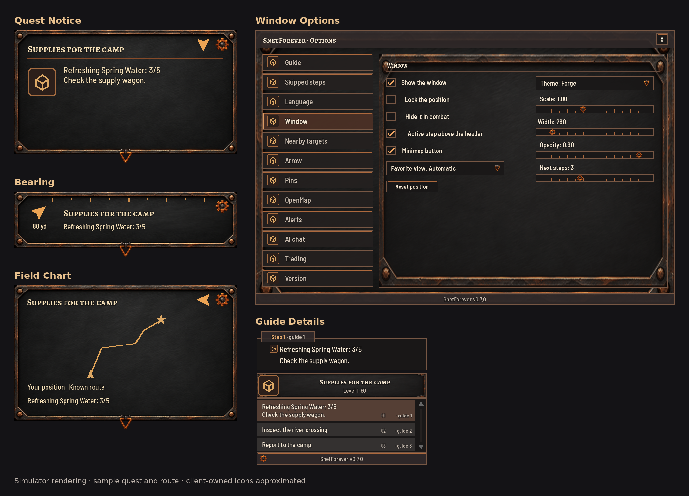

*Guide and settings, simulator rendering.* Open the gear to change the scale, lock the position or choose a favorite view. The copper handle opens the detailed step list. Dragging a guide frame moves the other views to the saved position.

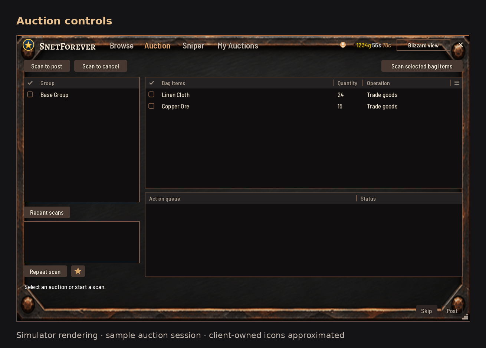

*Auction controls, simulator rendering.* The auction window brings the Forge header and navigation into the trading workflow. Availability events refresh the action button. Posting or cancelling still requires player input.

Both images use test fixtures and the simulator’s frame geometry, labels and addon textures. The previews use the bundled Forge fonts. Built-in game icons are approximated. The packaged client determines the final text metrics and placement.

### RestedXP guide imports

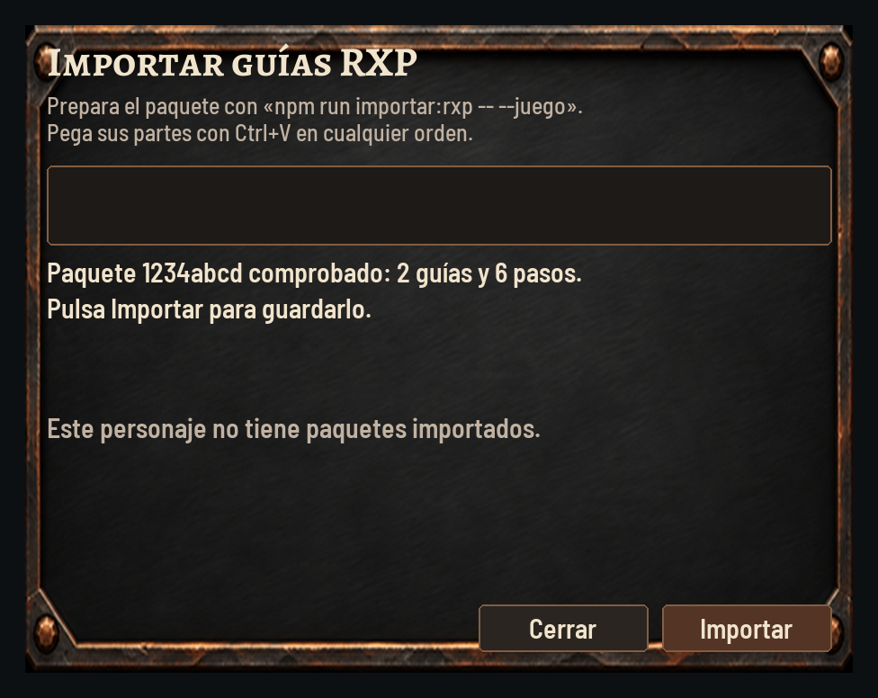

*Interface rendering with sample data.* The guide selector opens a separate dialog for pasting the parts of a guide package. It keeps the paste area, package status and confirmation visible together so the player can check the guide and step counts before saving. [Importing local RestedXP guides](../guides/importar-rxp.md)

### Window sizing

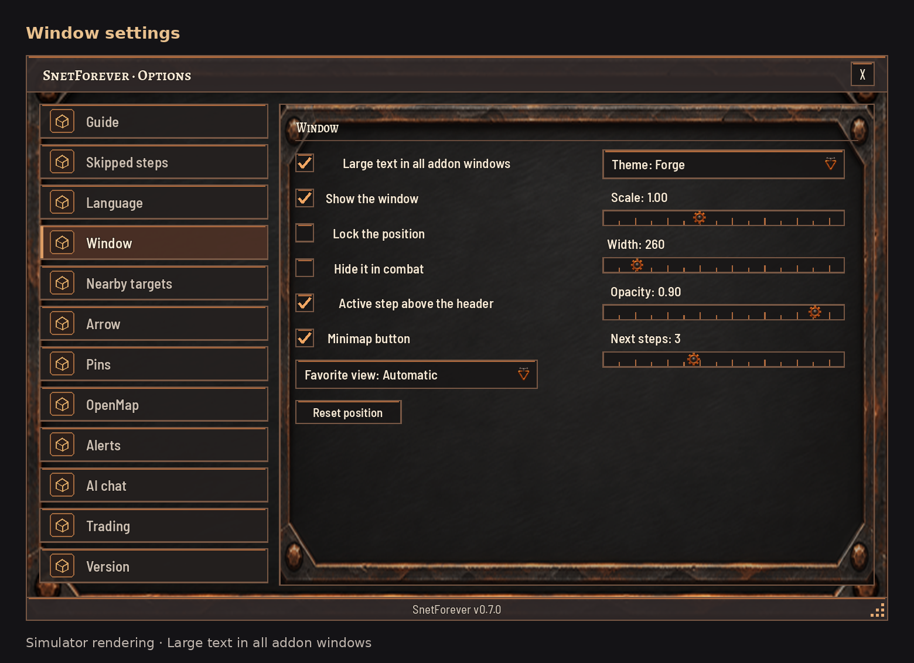

Open **/snet → Window → Large text in all addon windows** to enlarge labels and their controls together. The Sniper settings cog changes the same preference. Drag the lower-right grip on a floating guide view, Details, Chat, settings panel or editor to scale that window proportionally. Each window remembers its own size after a reload. The Blizzard settings category fits its available area.

The main Trade window and Auction House keep independent width and height controls. Their header tabs have individual two-axis grips and remember their sizes separately.

### Auction tab sizing

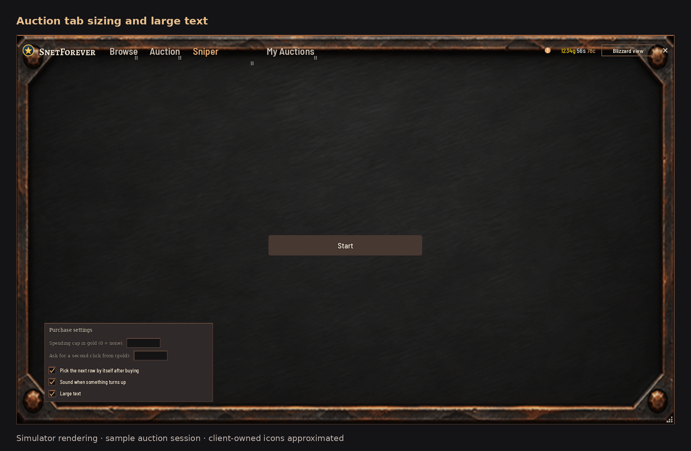

*Simulator rendering with Large text enabled.* Drag the grip at the lower right of an auction tab to change its width and height. The window remembers each tab separately. Drag the corner of the window to resize the trading area. Larger windows enlarge the page and its labels together. For additional magnification, select **Large text** from the Sniper settings cog.

### Group shopping

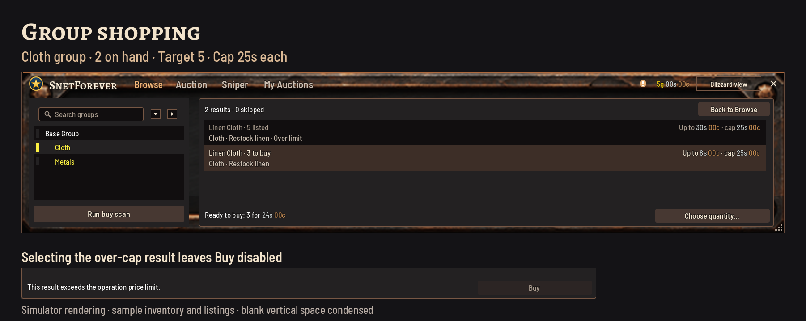

*Simulator rendering with sample data.* The result displays the applicable operation and price limit next to the recommended quantity. A player can see why an offer is above the limit before opening the quantity and confirmation controls. [Auction workflows](../comercio/auction-workflows.md)

### Warehousing preview and one move per click

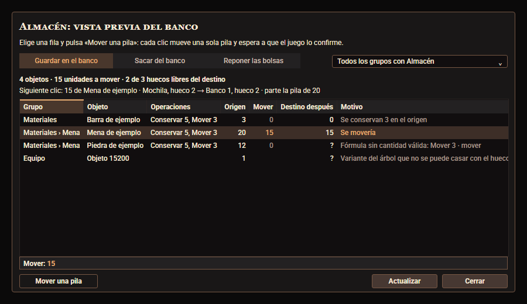

*Interface rendering with sample data, from the theme colors, bundled fonts and the existing table control.* `/snet c almacen` opens a separate window, so the main Trade window keeps its five tabs. The player chooses a direction and a group. Each row names the group and its Warehousing operations, the source quantity, what would move, the target total afterwards and, when nothing moves, why. Uncertain rows show a question mark instead of zero. After Alain approved one move per click on 26 November 2026, the player can choose one row. The line under the status names the next move, with the quantity and the source and target bag and slot. **Move one stack** moves only that stack and stays off until the game confirms it. The button sits apart from Refresh and Close, on the left, so a click meant for those never moves an item. When the client lacks the functions or blocks them, the window shows the read-only text and the button stays off. [Warehousing](../comercio/almacen.md)

### Vendoring preview

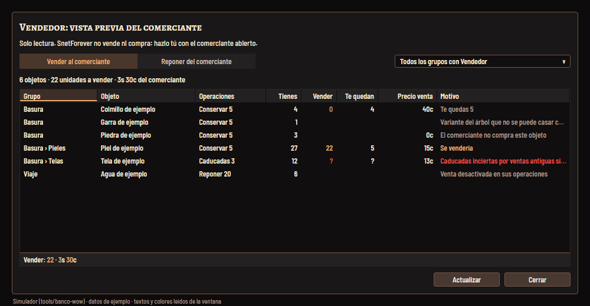

*Simulator rendering with sample data.* The texts and colors come from the window open in the addon simulator, drawn with the theme colors and bundled fonts. `/snet c vendedor` opens a separate window next to the merchant, so the main Trade window keeps its tabs. It reuses the Warehousing layout, the tabs, the group selector and the table control. The sell tab shows the units you have, what would be sold, what you would keep and the merchant's price. The restock tab shows the restock target, the merchant's stock, what would be bought and the cost. Uncertain rows show a question mark in red instead of zero. The window has no sell or buy button and closes with the merchant. [Vendoring](../comercio/vendedor.md)

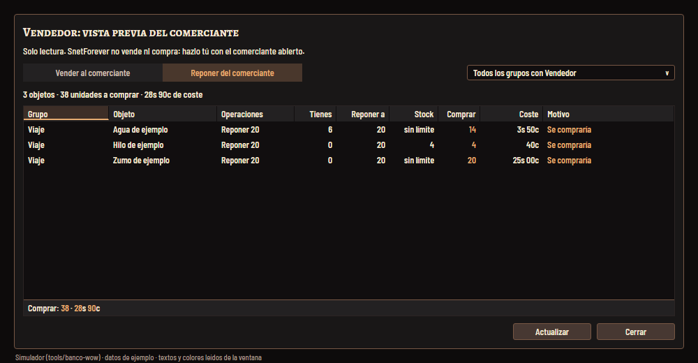

### Crafting restock preview

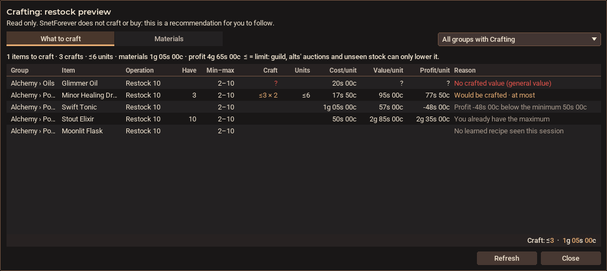

*Simulator rendering with sample data.* The texts and colors come from the window open in the addon simulator, drawn with the theme colors and bundled fonts. `/snet c artesania` opens a separate window, so the main Trade window keeps its tabs, and it works without a merchant, bank or profession window open. It reuses the Vendoring layout, the tabs, the group selector and the table control. **What to craft** shows the restock range, the crafts times the units per craft, and cost, value and profit per unit, so a player can see why an item is not queued. Crafts and units carry `≤` when stock the addon cannot see could lower them, and the status line says so instead of treating unseen stock as zero. **Materials** adds up the materials and the cost of what is missing from the bags. Uncertain rows show a question mark in red. The window has no craft or buy button. [Crafting](../comercio/artesania.md)

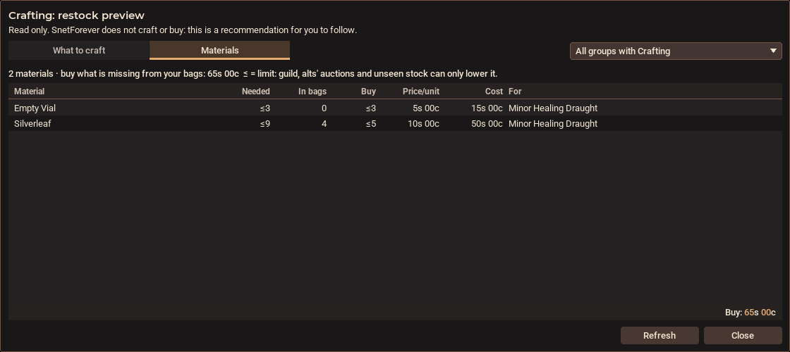

### Mailing send preview

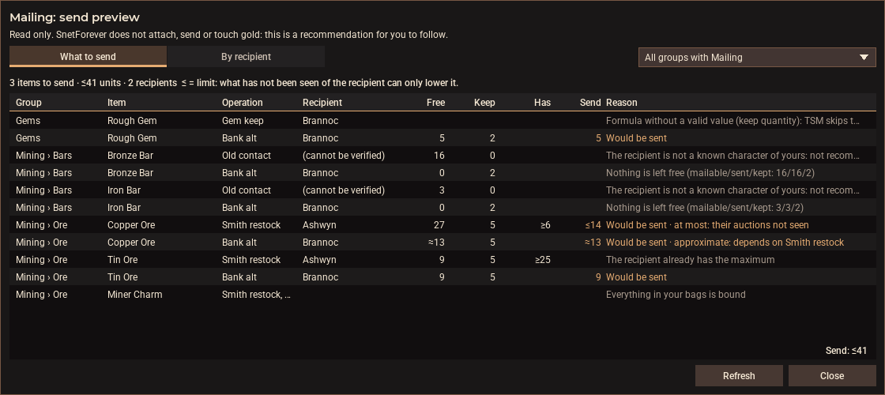

*Simulator rendering with sample data.* The texts, values and colors come from the window open in the addon simulator, drawn with the theme colors and bundled fonts. `/snet c correo` opens a separate window with the Crafting layout, the tabs, the group selector and the table control, and it works without the mailbox open. **What to send** has one row per item and operation, because TSM shares the free units between operations in order: each row shows the units still free, the keep quantity, what a restocked recipient already has and what would be sent. `≤` marks a limit that unseen stock of the recipient can only lower, and `≈` marks a quantity that depends on such a limit in an earlier operation. A recipient that is not one of the player's characters shows as *cannot be verified*, so another player's name never appears. **By recipient** adds up what each character would receive. The window has no send button and never writes in the mailbox form. [Mailing](../comercio/correo.md)

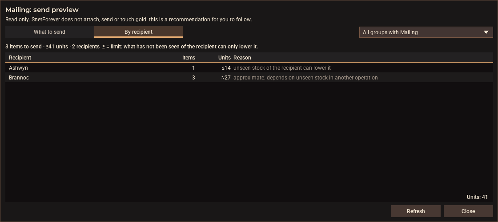

### Sniper mode

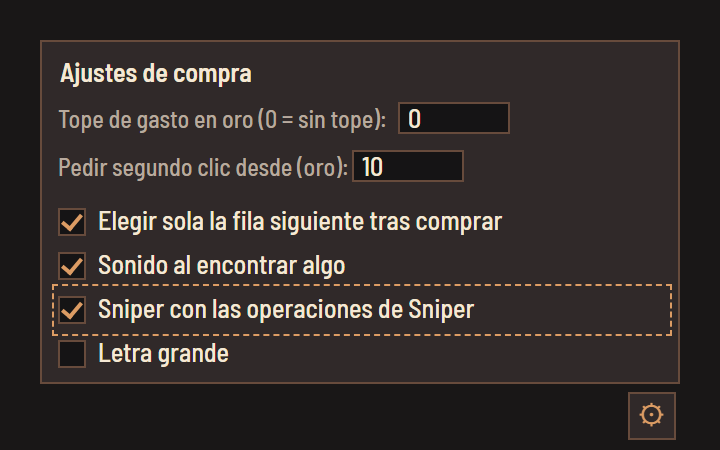

*Interface rendering from the simulator's frame geometry, labels, theme colors and bundled fonts. The dashed outline marks the new control and is absent from the game.* The settings cog that already holds the Sniper sound gains one checkbox. When selected, the Sniper uses each group's Sniper operation in place of the sniper percentage. The setting stays with the other Sniper preferences and needs no permanent control in the Sniper tab. Saved settings stay in the existing mode until the player selects the checkbox. [Auction workflows](../comercio/auction-workflows.md#sniping-with-group-operations)

### TSM import price diagnosis

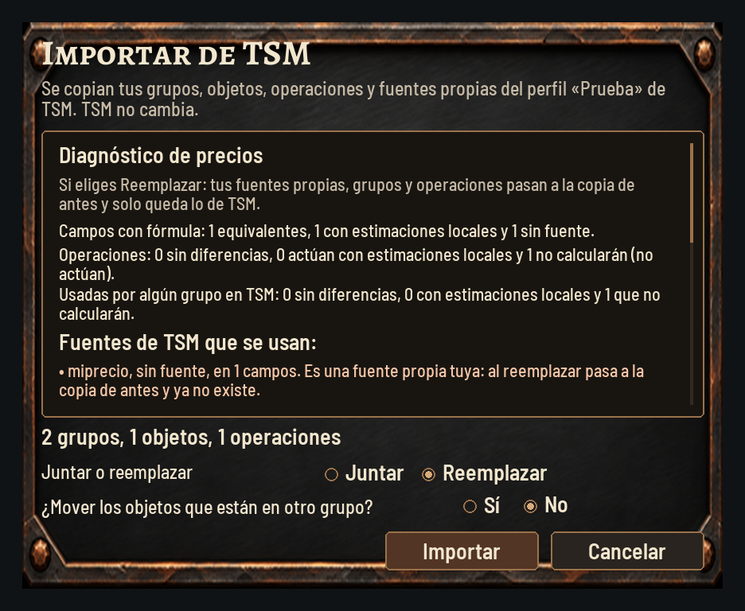

*Interface rendering with sample data.* The existing import box presents the price diagnosis for the selected mode above the migration details. The confirmation control is available once the preview matches that mode so the player can review which prices will change before applying the import. [Auction workflows](../comercio/auction-workflows.md)

### Auction price history

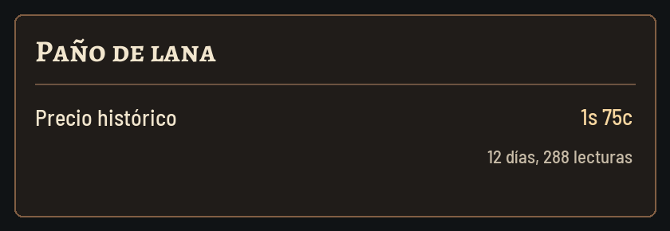

*Illustration using the simulator fixture.* The optional tooltip row puts the historical price beside its coverage. When the current house has too little history, the row explains why the value is unavailable. [Local market history](../comercio/auction-workflows.md#local-market-history)

### Typography

Alegreya SC Bold gives quest and section titles a carved small-cap shape. Barlow Semi Condensed Medium keeps objectives and settings readable in narrow panels. Barlow Semi Condensed SemiBold distinguishes buttons, prices and counts. The core addon bundles the static fonts so the guide can load them independently of the commerce module.

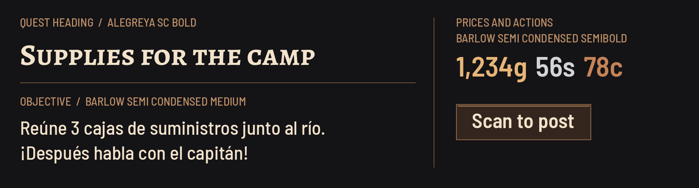

Both families ship with their SIL Open Font License. See [Alegreya SC](../../addons/SnetForever/recursos/fonts/alegreyasc-OFL.txt) and [Barlow Semi Condensed](../../addons/SnetForever/recursos/fonts/barlowsemicondensed-OFL.txt). The font files come from the [Google Fonts distribution](https://github.com/google/fonts/tree/06bfe0d62a98375cb09c942fa18e68bd32cff057/ofl).

### Materials and controls

| Iron plate | Copper hardware |
| --- | --- |
| 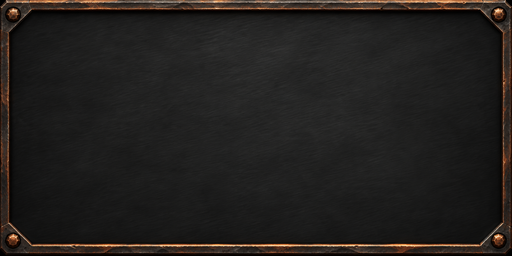 |  |
| Background for framed surfaces. The center accommodates text and changing data. | The cog identifies Options. The hanging ring identifies Details. |

The previews preserve the pixels of the [plate texture](../../addons/SnetForever/recursos/forge-plate.tga) and [two-icon atlas](../../addons/SnetForever/recursos/forge-controls.tga). The illustrations and textures were generated for SnetForever. Client fonts, player scale, and live quest text determine the final appearance in WoW Forever.

## How the design evolved

### Three views for one quest

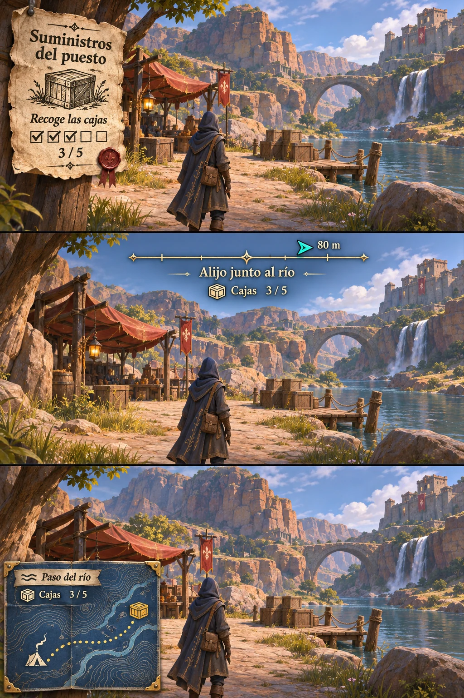

The team chose all three interaction models. **Quest Notice** introduces the assignment, **Bearing** guides travel, and **Field Chart** puts the player and destination in context. The views share one guide step and its counters. The first implementation exposed Details, navigation and pinning in a row of text buttons. Playtest feedback called for hardware that felt at home in the game. [Guide interactions](../guides/field-views.md)

Early parchment and indigo chart materials

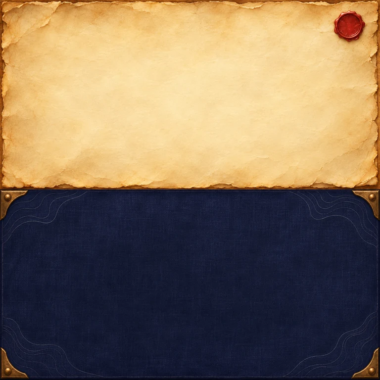

These textures document the first iteration of the views.

### Three treatments for controls and menus

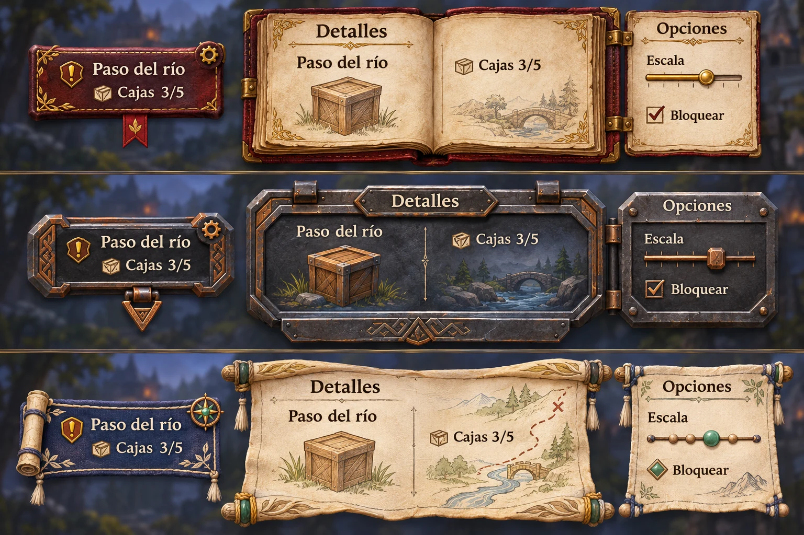

| Direction | Distinguishing control | Decision |
| --- | --- | --- |
| Adventurer's Journal | Red bookmark on a leather cover, with parchment settings | Alternative considered |
| Dwarven Forge | Hinged copper pull ring, toothed cog and dark iron plates | Selected |
| Explorer's Atlas | Rolled chart and compass rose on indigo linen | Alternative considered |

## Updating the gallery

For a visible change to a menu, control or guide view, update the image and its caption in the same PR. Label each image as concept art, a runtime asset preview, or an in-game capture. Record the selected behavior and the reason for it. Use a sanitized test profile for in-game captures.
